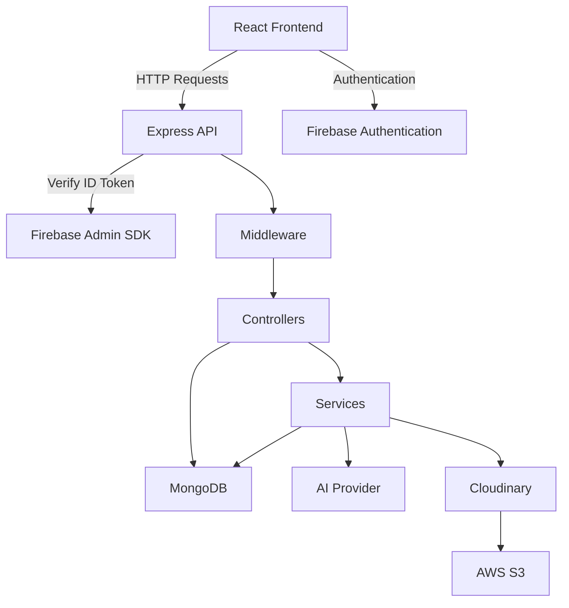

# System Architecture

## Overview

T-World uses a client-server architecture with a React frontend, an Express.js REST API, and MongoDB for persistent data storage.

Firebase Authentication handles user identity verification. The backend validates Firebase ID tokens and applies role-based authorization before allowing access to protected resources.

Cloudinary and AWS S3 provide the media upload and storage workflow.

## High-Level Architecture

## Backend Organization

The backend follows a modular structure that separates HTTP handling, business logic, data persistence, and request validation.

### Configuration

`backend/src/config/`

Contains application configuration, database connectivity, environment validation, and Firebase Admin initialization.

### Controllers

`backend/src/controllers/`

Handle incoming requests, validate request data, invoke application services, and return HTTP responses.

Controllers include:

- Authentication controller
- Content controller
- AI controller
- Token controller
- Media controller

### Middleware

`backend/src/middleware/`

Contains authentication and authorization middleware.

- Authentication verifies Firebase ID tokens.
- Authorization restricts administrator-only operations.

### Models

`backend/src/models/`

Defines MongoDB schemas and indexes using Mongoose.

| Model              | Responsibility                              |
| ------------------ | ------------------------------------------- |
| User               | User identity, role, and token balance      |
| Content            | Content records and ownership               |
| AiRun              | AI execution history and reward information |
| TokenTransaction   | Token transaction ledger                    |
| ContractConversion | Simulated asset conversions and withdrawals |
| Media              | Uploaded media metadata and storage status  |

### Routes

`backend/src/routes/`

Defines REST API endpoints and connects them to middleware and controllers.

### Services

`backend/src/services/`

Contains reusable business logic and external provider integrations.

Service areas include:

- AI provider abstraction and timeout handling.
- AI reward processing.
- Token conversion and withdrawal.
- Cloudinary upload and AWS S3 promotion.

### Validators

`backend/src/validators/`

Contains Zod schemas for validating request parameters, query strings, and request bodies.

## Main Application Workflows

### 1. Authentication

1. A user signs in through Firebase Authentication.
2. The frontend obtains a Firebase ID token.
3. The frontend includes the token in protected API requests.
4. The backend verifies the token through Firebase Admin SDK.
5. The backend resolves the application user and role.
6. Authorization middleware checks permissions where required.

### 2. Content Management

1. An authenticated user submits content.
2. The API validates the request using Zod.
3. The content controller creates the record.
4. MongoDB stores the content and creator reference.
5. Public endpoints support listing, searching, filtering, and pagination.

### 3. AI Summarization and Token Rewards

1. An authenticated user requests a summary for existing content.
2. The API validates the content ID and summarization options.
3. The AI controller retrieves the content.
4. The configured AI provider generates the summary.
5. A timeout protects the request from excessive provider delays.
6. The application records the AI execution details.
7. The reward service awards 5 tokens for a successful run.
8. The user balance and token transaction ledger are updated.
9. The API returns the summary, AI run ID, reward, and updated balance.

The current summarization flow uses a mock AI provider.

### 4. Token Conversion

1. An authenticated user submits a conversion request.
2. The API validates the requested asset and amount.
3. The conversion service checks the user's available token balance.
4. A MongoDB transaction updates the user balance and records the conversion and token transaction.
5. The API returns the simulated conversion result.

MongoDB transactions help maintain consistency across related database updates.

### 5. Simulated Withdrawal

1. An authenticated user requests a withdrawal.
2. The withdrawal service checks eligible converted assets.
3. The simulated withdrawal is recorded.
4. The conversion record is updated with withdrawal information.
5. The API returns the result.

No real blockchain transaction or financial transfer takes place.

### 6. Media Upload and Promotion

1. An authenticated user uploads a file through the media endpoint.
2. Multer processes the multipart upload in memory and enforces the 10 MB limit.
3. The file is uploaded to Cloudinary as temporary storage.
4. MongoDB stores the media metadata and ownership information.
5. The owner requests promotion of the media record.
6. The backend retrieves the temporary Cloudinary asset and uploads it to AWS S3.
7. The media record is updated with its S3 location and promoted status.

## Data Relationships

- A user can create multiple content records.
- A user can have multiple AI execution records.
- Each AI execution references a user and a content record.
- A user can have multiple token transactions.
- A user can have multiple conversion records.
- A user can upload multiple media records.

MongoDB ObjectId references connect related records.

## Security and Reliability

The backend includes:

- Firebase ID token verification.
- Role-based access control.
- Zod request validation.
- Helmet security headers.
- Configurable CORS.
- API rate limiting.
- Centralized error handling.
- Ownership checks for media operations.
- Database transactions for token conversion and reward processing.

## Deployment Considerations

The frontend and backend can be deployed independently.

Production deployment requires:

- A configured MongoDB database.
- Firebase project credentials.
- Correct frontend and backend environment variables.
- Cloudinary credentials.
- AWS S3 bucket and access configuration.
- HTTPS for production traffic.
- Correct CORS configuration for the deployed frontend origin.

The frontend should be built using `npm run build` and served through a suitable static hosting provider. The backend should be compiled using `npm run build` and started using `npm start`.
